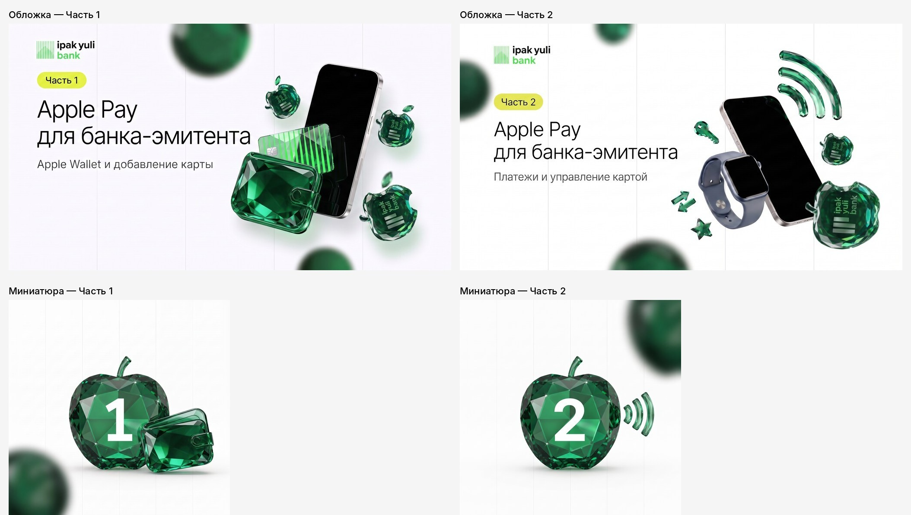

# Обложки курса «Структура взаимодействия банка-эмитента с Apple Pay»



| Файл | Размер | Что это |
|---|---|---|
| `cover_part1.png` | 1920×1080 | обложка, Часть 1 — Apple Wallet и добавление карты |
| `cover_part2.png` | 1920×1080 | обложка, Часть 2 — Платежи и управление картой |
| `thumb_part1.png` | 1080×1080 | миниатюра, Часть 1 |
| `thumb_part2.png` | 1080×1080 | миниатюра, Часть 2 |
| `cover_part1_ru_uz.png` | 1920×1080 | обложка, Часть 1, на русском и узбекском |
| `cover_part2_ru_uz.png` | 1920×1080 | обложка, Часть 2, на русском и узбекском |
| `thumb_part1_ru_uz.png` | 1080×1080 | миниатюра, Часть 1 · 1-qism |
| `thumb_part2_ru_uz.png` | 1080×1080 | миниатюра, Часть 2 · 2-qism |

Обложки собраны из оригинальных объектов курса: изумрудных яблок, кошелька, карты, иконок и мокапов устройств из презентации. Логотип банка вставлен как есть. Шрифт Manrope, как в курсе, акцентный цвет #DDE81B.

## Как пересобрать

Исходники лежат в `source/`: `make.py` генерирует HTML, `shot.js` рендерит его в PNG через Playwright, объекты лежат в `source/a/`.

```bash
cd source
npm pack @fontsource/manrope@5.0.20 && tar xzf fontsource-manrope-5.0.20.tgz   # шрифт Manrope
mkdir -p out && python3 make.py && node shot.js                                  # результат в out/
```

Тексты, позиции и размеры объектов задаются в `make.py`.
